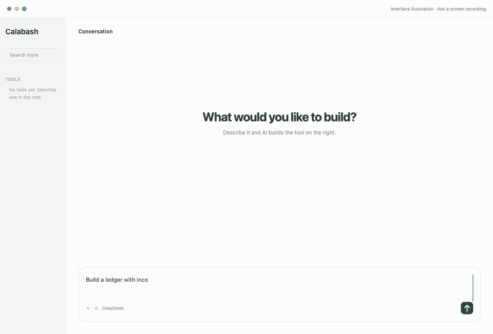

# Calabash

**Everyone should be able to create their own app.**

English | [中文](README.zh-CN.md)

Calabash turns your ideas into interactive tools with AI—built for you, running on your desktop.

## From a request to a tool you can keep using



*The chat generation sequence is an illustration with accelerated waiting. Tool interactions are real recordings using synthetic data.*

1. **Describe it.** Explain your inputs, requirements and intended result.
2. **Try it.** Adjust parameters, inspect results and keep chatting to refine the tool.
3. **Keep it.** Save it locally, use it again, or share it as a tool ZIP.

Start with a small idea. It does not need to become a large product, or look like anyone else’s.

Explore the [product website](website/index.html?lang=en) and [guide](website/guide.html?lang=en). The demonstrations show examples you can create, rather than a fixed boundary for the app.

## What it offers today

- **Create and edit tools in chat:** configure an external model and iterate on local tools through conversation.
- **Interfaces you can use:** forms, tables, charts and interactive previews.
- **Local file workflows:** choose files, run individual or batch jobs, follow progress and result history, and deliver new output files.
- **Controlled execution:** duplicate-submission prevention and safe cancellation. With your confirmation, send a necessary error summary to the agent for repair, then retry manually.
- **Local storage and sharing:** organize tools by project and import or export local tool ZIPs.
- **Extensible runtime capabilities:** common document, spreadsheet and image libraries are bundled. Optional capabilities such as FFmpeg are imported as local signed plugin ZIPs.
- **Chinese and English UI.**

What a particular tool can do depends on its requirements, generated code, selected model and available runtime capabilities. Check generated behavior and results before relying on them.

## Getting started

Calabash is in preview. Check [Releases](https://github.com/rangwea/calabash/releases) for publicly available versions. If no installer is available, run it from source.

Desktop packages include the Python backend and built-in runtime libraries. End users do not need Python or uv. Configure your model API and key in Settings, select a model, and start a conversation. No Calabash account is required.

CI builds are configured for macOS Apple Silicon, macOS Intel and Windows x64. Actual platform readiness depends on installer testing. Developer distribution signing and Apple notarization are not configured yet.

### Files and data

Tool source lives in `~/.calabash/tools`. Indexes, conversations and execution records are stored locally using SQLite. Loopback HTTP is internal communication between the desktop shell and local backend, not a remote administration service.

**Local execution does not mean offline AI.** Conversation messages and relevant file contents read by the agent may be sent to your selected external model provider. Review these boundaries before working with sensitive files.

Tool ZIPs contain executable source. Import only trusted tools, and check for keys or business data before sharing. ZIP validation is not a security sandbox.

## Local development

Requires Python 3.13+, [uv](https://docs.astral.sh/uv/), Node.js 22 and Rust/Cargo.

```bash
git clone https://github.com/rangwea/calabash.git
cd calabash
uv sync --frozen
npm ci
npm run desktop:dev
```

To run just the Python interface:

```bash
uv run python3 main.py
```

The backend chooses an available port on `127.0.0.1`. Read the startup log for its URL.

### Building and releasing

```bash
npm run desktop:build
```

PyInstaller packages the backend and checks bundled runtime libraries, then Tauri creates the installer. Default macOS outputs are under `src-tauri/target/release/bundle/`.

The [GitHub Release workflow](.github/workflows/release.yml) supports:

- Manually running **Build release app** to produce installer artifacts for three platforms, retained for 14 days.
- Pushing a `v<version>` tag matching `package.json` to create a draft release with installers after all builds succeed.
- Rerunning a tag to update draft assets only. Published releases are not overwritten. Test each platform’s installer before publishing the draft manually.

It uses the automatically provided `GITHUB_TOKEN`, without an additional publishing token. Optional capability plugins are distributed separately from the main app.

### Checks

```bash
uvx --offline ruff check
.venv/bin/python3 -m unittest discover -s tests
node --test tests/tool_activity.test.mjs
cargo test --manifest-path src-tauri/Cargo.toml
```

### Repository structure

| Path | Purpose |
| --- | --- |
| `src-tauri/`, `desktop-ui/` | Native window, desktop bridge and startup screen |
| `backend/`, `main.py` | Python backend and development entry point |
| `ui/`, `component/` | Pages and reusable UI components |
| `service/`, `api/` | Business services and internal local APIs |
| `core/`, `models/` | Runtime infrastructure, localization and data models |
| `agent/skills/calabash/` | Bundled agent skill and tool conventions |
| `website/` | Independent bilingual website, guide and demo assets |
| `scripts/`, `tests/` | Build scripts and regression tests |

Built with Tauri v2, Python, NiceGUI, FastAPI and SQLite. Dependencies are defined in `pyproject.toml`, `uv.lock` and the npm lockfile. The app does not read `.env`. See [AGENTS.md](AGENTS.md) for development conventions and the [Roadmap](ROADMAP.md) for planned work.

## Build with us

Share a tool idea or report a problem through [Issues](https://github.com/rangwea/calabash/issues), or contribute a Pull Request. Use synthetic examples when reporting problems, and leave out model keys and sensitive files.

We hope that one day, when something feels harder than it should, your next thought is not only “Is there an app for that?” but also: **“I could make my own.”**

## License

Calabash is source-available under the [Elastic License 2.0 (ELv2)](LICENSE). It is not OSI-approved open source.

Personal use, internal business use, modification and redistribution are permitted subject to the license. You may not offer Calabash as a hosted or managed service that gives third parties access to a substantial set of its features. This restriction is not limited to paid services. You must not circumvent license-key functionality or remove licensing, copyright or other licensor notices.

ELv2 does not impose a blanket ban on selling redistributed desktop copies. Third-party components retain their own licenses. See [NOTICE](NOTICE); the full license text controls.

## Why Calabash exists

General-purpose AI agents can process files, operate browsers, write code and carry out increasingly complex tasks. Explain what you need, and they can often deliver a useful result.

Then next week, the same task comes around again.

You bring a new file, explain the rules again, repeat the details you clarified last time, and wait for the agent to understand, plan and execute. More tokens are spent. The result may also differ: columns move, a calculation changes, or a step you already settled needs correcting again.

That flexibility is valuable for a one-off task. But when a method works and the job will repeat, we want to keep it.

**What if a problem solved in one conversation could become an app you simply open next time?**

That is the idea behind Calabash.

The first time, describe your needs in chat and let AI create a tool. Try it in the preview beside the conversation, refine the rules, interface and results, then save it on your computer.

Next time, open the tool, change the input and run it. Processing logic already captured in code can be reused without asking a model to reason through and generate it again. Operations that do not call a model consume no model tokens. When your needs change, return to the conversation and edit the tool.

Saved code makes the rules inspectable and reusable. It still needs testing, and steps that depend on external models or services can still vary. But you have an implementation you can keep improving, rather than only the result of a previous chat.

A tool does not have to serve everyone. It can fit your way of working, solve a problem that matters to you, and grow as your ideas change.

**We hope for an era of apps made by everyone: creating software becomes a way for anyone to express an idea and solve a problem, as well as a profession.**

Calabash starts with personal desktop tools. It is a step in that direction.
