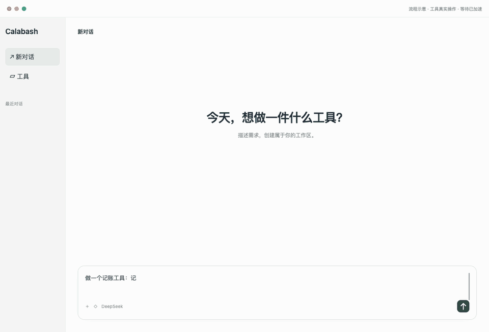

# Calabash

**让每个人，都能创造自己的 App。**

[English](README.md) | 中文

Calabash turns your ideas into interactive tools with AI—built for you, running on your desktop.

## 从一句话，到一件可以继续用的工具



*聊天生成部分为流程示意，等待已加速；预览中的工具操作为真实录制，使用合成数据。*

1. **说出来。** 描述需求、输入和希望得到的结果。
2. **试一试。** 在工具界面中填写参数、查看结果，继续对话调整。
3. **留下来。** 工具保存在本机，可以反复使用，也可以通过 ZIP 导出分享。

你可以从一个很小的想法开始。它不需要是宏大的产品，也不需要和别人一样。

更多场景见[产品介绍](website/index.html)与[使用指南](website/guide.html)。演示中的工具是可创建的示例，不是 App 的固定功能边界。

## 现在可以做什么

- **对话创建和修改工具**：选择自己配置的外部模型，在聊天中迭代本地工具。
- **有界面的操作**：表单、表格、图表与交互预览，让工具可以被直接使用。
- **本地文件处理**：选择文件，执行单项或批量任务，查看进度与结果历史，交付新的结果文件。
- **可控的执行过程**：防重复提交、安全取消；出错后可确认发送必要摘要给 Agent 修复，再手动重试。
- **本地保存与分享**：按项目整理工具，支持本地 ZIP 导入、导出。
- **扩展运行能力**：常用文档、表格和图片库随 App 打包；FFmpeg 等可选能力通过本地签名插件 ZIP 导入。
- **中英文界面**：按习惯使用中文或英文。

具体工具能做什么，取决于需求、生成的代码、所选模型和可用运行能力；生成后仍应检查行为与结果。

## 开始使用

Calabash 目前处于预览阶段。可在 [Releases](https://github.com/rangwea/calabash/releases) 查看已公开的版本；若暂无安装包，可从源码运行。

桌面安装包包含 Python 后端和内置运行库，最终用户不需要安装 Python 或 uv。首次使用需在设置中配置模型 API 和密钥，再选择模型开始对话；不需要 Calabash 账号。

目前配置了 macOS Apple Silicon、Intel 与 Windows x64 的 CI 构建，各平台实际可用性以安装包验收为准。开发者分发签名和 Apple 公证尚未接入。

### 文件和数据

工具源码位于 `~/.calabash/tools`，本地索引、对话及运行记录使用 SQLite 保存。回环 HTTP 仅用于桌面壳与本地后端通信，不提供远程管理服务。

**本地运行不代表模型离线运行。** 对话消息和 Agent 读取的相关文件内容可能发送给你选择的外部模型服务商。处理敏感文件前，请确认数据边界。

工具 ZIP 包含可执行源码。只导入可信来源，分享前检查密钥和业务数据；ZIP 导入检查不等于安全沙箱。

## 本地开发

需要 Python 3.13+、[uv](https://docs.astral.sh/uv/)、Node.js 22 和 Rust/Cargo。

```bash
git clone https://github.com/rangwea/calabash.git
cd calabash
uv sync --frozen
npm ci
npm run desktop:dev
```

仅启动 Python 界面：

```bash
uv run python3 main.py
```

启动时自动选择 `127.0.0.1` 上的可用端口，以日志为准。

### 构建与发布

```bash
npm run desktop:build
```

构建先用 PyInstaller 打包后端并检查内置运行库，再由 Tauri 生成安装包。默认 macOS 产物位于 `src-tauri/target/release/bundle/`。

[GitHub Release 工作流](.github/workflows/release.yml)支持：

- 手动运行 **Build release app**，生成三个平台的安装包 Artifacts，保留 14 天。
- 推送与 `package.json` 版本一致的 `v<版本号>` 标签，全部构建成功后创建 Release 草稿并上传安装包。
- 同一标签重跑只更新草稿，不覆盖已发布的 Release；验收各平台安装包后再手动发布。

使用 GitHub 自动提供的 `GITHUB_TOKEN`，无需额外发布令牌。可选能力插件独立分发，不打进主 App。

### 检查

```bash
uvx --offline ruff check
.venv/bin/python3 -m unittest discover -s tests
node --test tests/tool_activity.test.mjs
cargo test --manifest-path src-tauri/Cargo.toml
```

### 项目结构

| 路径 | 职责 |
| --- | --- |
| `src-tauri/`、`desktop-ui/` | 原生窗口、桌面桥接与启动页 |
| `backend/`、`main.py` | Python 后端与开发入口 |
| `ui/`、`component/` | 页面与可复用界面组件 |
| `service/`、`api/` | 业务服务与本地内部 API |
| `core/`、`models/` | 运行基础设施、国际化与数据模型 |
| `agent/skills/calabash/` | 随 App 内置的 Agent Skill 与工具规范 |
| `website/` | 独立中英文产品网站、指南与演示素材 |
| `scripts/`、`tests/` | 构建脚本与回归测试 |

技术栈：Tauri v2、Python、NiceGUI、FastAPI、SQLite。依赖以 `pyproject.toml`、`uv.lock` 和 npm 锁文件为准，不读取 `.env`。更多开发约定见 [AGENTS.md](AGENTS.md)；后续方向见 [Roadmap](ROADMAP.md)。

## 一起创造

欢迎通过 [Issues](https://github.com/rangwea/calabash/issues) 分享你想创造的工具、使用中遇到的问题，或通过 Pull Request 改进 Calabash。报告问题时请使用合成样例，不附带模型密钥或敏感文件。

希望有一天，遇到一件不顺手的事，你想到的不只是“有没有这样的 App”，还有：**“我可以做一个自己的。”**

## 许可证

Calabash 采用 [Elastic License 2.0（ELv2）](LICENSE)，属于源码可用项目，不属于 OSI 认可的标准开源项目。

在遵守许可证的前提下，允许个人使用、企业内部使用、修改和再分发。不得将 Calabash 作为托管或管理服务提供给第三方，让第三方访问其重要功能；这项限制不限于收费服务。不得绕过许可证密钥功能，也不得移除许可、版权或其他许可方声明。

ELv2 并不全面禁止售卖再分发的桌面版本。第三方组件仍遵循各自许可证。版权信息见 [NOTICE](NOTICE)，具体权利和限制以英文许可证全文为准。

## 为什么会有 Calabash

通用 AI Agent 已经能帮我们处理文件、操作浏览器、编写代码，完成越来越复杂的工作。很多时候，只要把需求说清楚，它就能交出一份不错的结果。

但到了下周，同样的事情又来了。

你换了一份文件，重新解释规则，补充上次强调过的细节，再等它理解、规划、执行。又消耗了一轮 Token，也可能得到和上次不太一样的结果：字段顺序变了，统计口径偏了，某个已经确认过的步骤又需要重新纠正。

对于临时任务，这样的灵活性很有价值。但对已经做对、还会反复做的事情，我们希望能把验证过的方法留下来。

**如果一次对话解决的问题，能变成一个下次直接打开的 App 呢？**

这就是 Calabash 想做的事。

第一次，用对话描述需求，让 AI 创建工具。在旁边的预览中试用，把规则、界面和结果调整到满意，再将它保存在自己的电脑上。

下一次，打开工具，换一份输入，点击运行。已经写进代码的处理流程可以直接复用，不必每次都让模型重新推理和生成；不调用模型的操作，也无需消耗模型 Token。需求变了，再回到对话里修改这件工具。

保存下来的代码让处理规则可以被检查和复用。它仍然需要测试，依赖外部模型或服务的步骤也仍可能变化，但你有了一份可以持续改进的实现，而不只是上一次聊天里的结果。

工具不必为所有人而设计。它可以只服务你的工作方式，只解决你在意的问题，也可以随着你的想法慢慢长大。

**我们期待一个全民 App 的时代：创造软件不再只是少数人的职业，也可以是每个人表达想法、解决问题的方式。**

Calabash 从个人桌面工具开始，朝这个方向迈一步。
